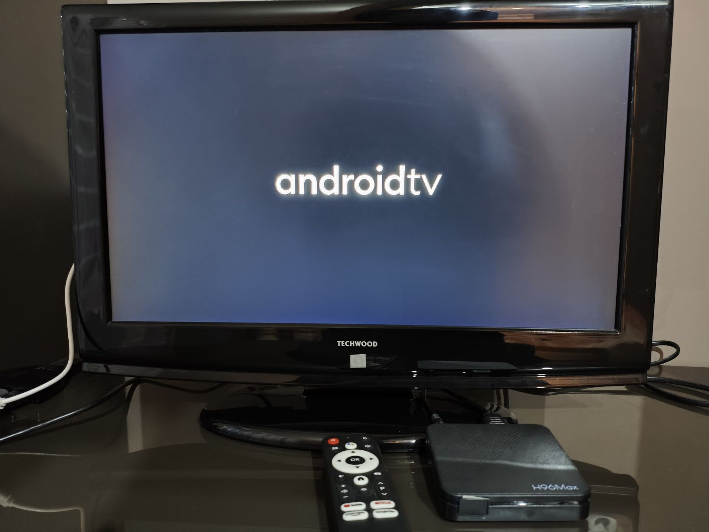
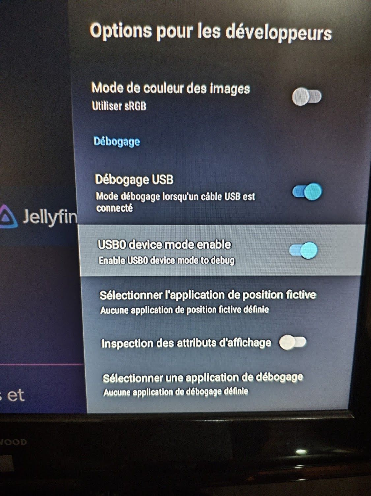
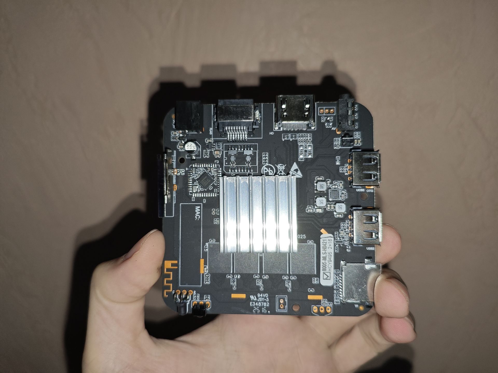
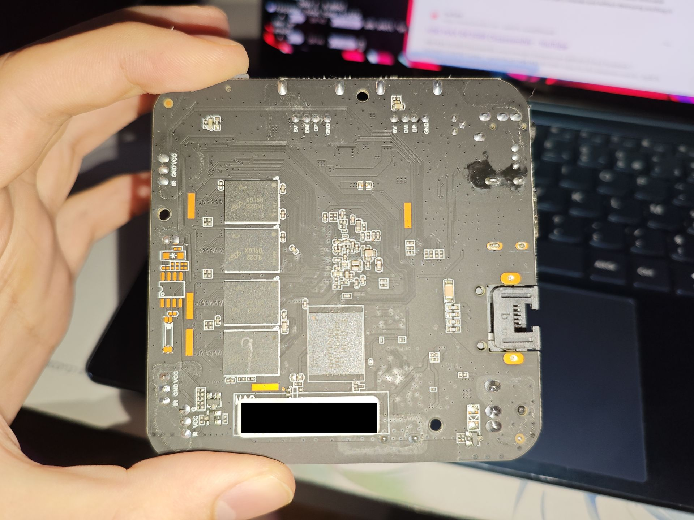
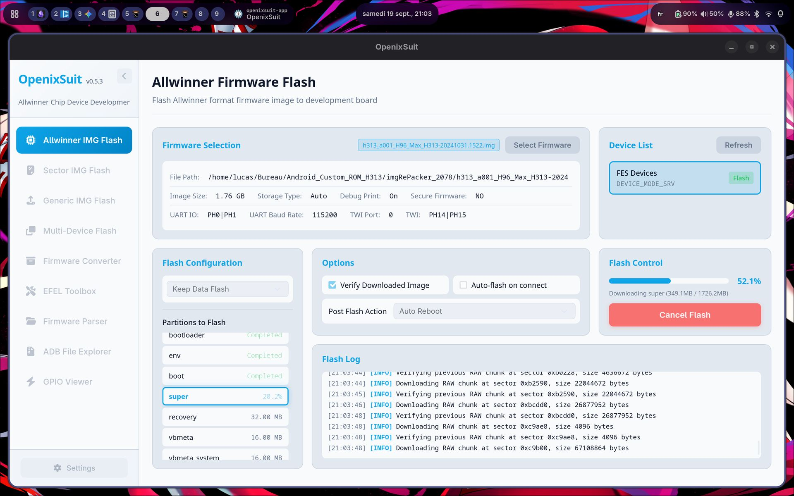
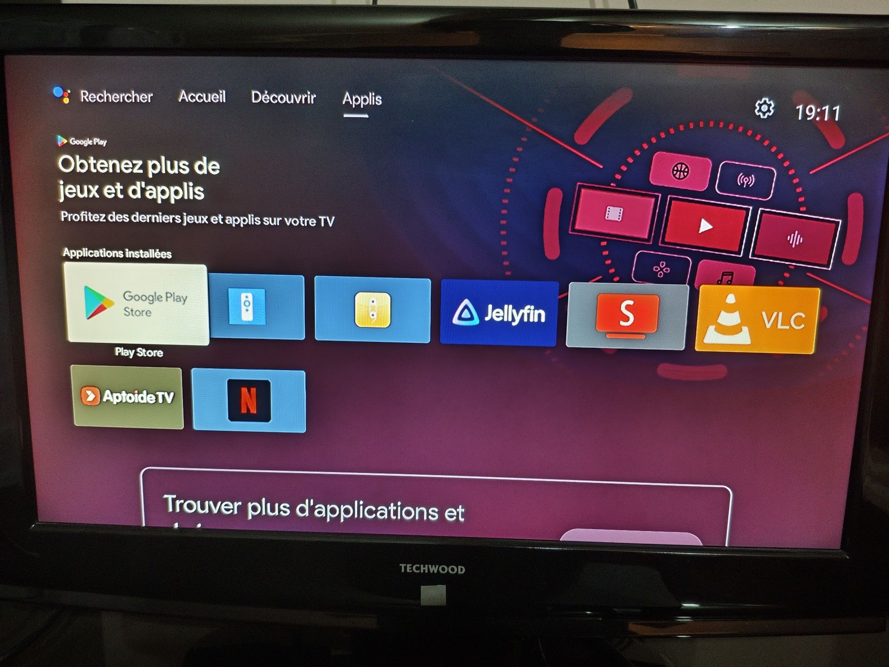

# Cheap Chinese TV Boxes: Reverse Engineering and Cleaning



My parents bought a cheap AliExpress Android TV box to watch Netflix, only to find it utterly useless. Being uncertified, it can't run the official Android TV app and instead relies on a sketchy mobile phone build I wouldn't trust with my credentials. 
Here, I detail my journey tearing down the stock firmware of an Allwinner H313 box (here a H96 Max), extracting partitions and crafting a debloated system preserving essential features.

## Getting a way into the device

The first step was to get an ADB shell into the device. That was actually pretty easy: the classic trick of tapping multiple times on the build number unlocked Developer Options, where enabling "ADB over USB" and "USB0 device mode enable" did the job.



My first attempt was to check if we had root access on the device... and sure enough, running a simple `adb root` yielded an elevated shell right away. This made the subsequent firmware extraction and inspection significantly easier.

### Disassembly
To get more info on the hardware, I disassembled the box and took some photos of the board:





Nothing really surprising here. It's a fairly standard, barebones Allwinner H313 board design (`eros-p1`) equipped with cheap eMMC and basic passive cooling.

## Partition Layout & Firmware Extraction

Before making any modifications, creating a full raw dump of the eMMC was paramount. Examining `/proc/partitions` and `/dev/block/by-name/` revealed a dynamic partition setup:

- `/dev/block/by-name/boot` (32 MB) -> Kernel & Ramdisk
- `/dev/block/by-name/super` (2 GB) -> Dynamic container wrapping `system`, `vendor`, and `product`
- `/dev/block/by-name/vbmeta*` -> AVB / dm-verity structures (secure boot is disabled, completely useless)
- `/dev/block/by-name/env` -> U-Boot environment

I dumped the partitions over ADB using:
```bash
adb exec-out "dd if=/dev/block/by-name/boot bs=4M status=none" > boot.img
adb exec-out "dd if=/dev/block/by-name/super bs=4M status=none" > super.img
adb exec-out "dd if=/dev/block/by-name/vbmeta bs=4M status=none" > vbmeta.img
```

## Analysing Firmware

### The "Android 14" Lie
The first thing I was dubious about was the device's Android 14 claim. Many parts of the system didn't feel like Android 14 at all: the legacy power-off dialog, dated settings menus, and the complete absence of Material You made me suspect it was Android 9, 10, or 11 at best.

Querying `build.prop` immediately unmasks the deception:
```properties
ro.system.build.fingerprint=google/walleye/walleye:10/QP1A.191105.004/5908170:user/release-keys
ro.system.build.id=QP1A.191105.004
ro.system.build.version.release=14
ro.system.build.version.sdk=29
```

`ro.build.version.sdk=29` corresponds to **Android 10 (API level 29)** spoofing a Google Pixel 2 (`walleye`) build signature, with `ro.system.build.version.release` crudely overridden to display `14`. 

In our cleaned custom build, I restored `ro.build.version.release=10` to make it coherent with SDK 29.
### Permissive Kernel Security
Inspecting the boot image header and kernel command line (`boot.img`):

```text
CMDLINE [firmware_class.path=/vendor/etc/firmware selinux=1 androidboot.selinux=permissive androidboot.dtbo_idx=0,1,2 buildvariant=userdebug]
```

- **`androidboot.selinux=permissive`**: SELinux enforcement is deliberately neutralized at kernel boot time, allowing any unprivileged process service to escalate privileges.
- **`buildvariant=userdebug`**: Debug build flags are left enabled out-of-the-box.
### Auditing the Stock System (`/system`)
Mounting the dynamic `system` partition exposed severe security threats including active backdoors, deliberate system sabotage, and massive piles of bloatware:
- **`/system/bin/devTest`**: A C2 backdoor communicating with `monitor.hcybox.com` (IP `47.116.140.182`), launched with root privileges on boot.
- **`/system/bin/qw` & `qw.rc`**:  `su` daemon running in the background (`/dev/com.koushikdutta.superuser.daemon`), managing silent root access.
- **`/system/app/RemoteHelper/`**: A mouse control program but seems to be also a remote desktop takeover backdoor.
- **`HcyDeviceTest1`**: Residual OEM factory testing and diagnostics tools.
- **`appsdisable.rc` / `appsdisable`**: Vendor script specifically designed to forcibly disable some Google services on boot.
- **`preinstall.rc` / `preinstall`**: Initialization routine that forcibly disabled ADB (`settings put global adb_enabled 0`), turned off Android package verification, and looped through preloaded APKs.
- **`awlogd`**: Allwinner telemetry and logging daemon constantly writing verbose logs to disk.
## Debloating and Rebuilding the Firmware

### FEL Mode

Thankfully, Allwinner SoCs feature a low-level recovery protocol built directly into the on-chip BROM. 

If the bootloader fails or if the recovery button (hidden inside the 3.5mm AV jack) is pressed with a toothpick while connecting a male-to-male USB-A cable to the OTG port (USB0), the SoC halts its normal eMMC boot sequence and enters FEL mode. 

Checking with `lsusb`:
```text
Bus 005 Device 002: ID 1f3a:efe8 Allwinner Technology sunxi SoC OTG connector in FEL/flashing mode
```

We can query the chip using `sunxi-fel`:
```bash
sudo sunxi-fel ver
# AWUSBFEX soc=00001823(unknown) 00000001 ver=0001 44 08 scratchpad=00007e00 00000000 00000000
```

This is great because it makes the box almost **unbrickable**. Even if eMMC is completely corrupted, we can flash firmware directly over USB.
### Making a Custom Phoenix ROM

Allwinner flashing utilities expect a proprietary packed firmware image format rather than raw partition dumps. To build our modified firmware, the pipeline looked like this:

1. Download a compatible factory `.img` for the H313 board to use as a base container.
2. Using **RedScorpio Image Unpacker**, unpack the factory `.img` into individual `.fex` partition files.
3. The stock firmware wraps the Android 10 partitions inside `super.fex` / `super.img`. Using `lpunpack`, extract the dynamic sub-images:
   ```bash
   mkdir -p extracted_super
   lpunpack super.img extracted_super/
   # Produces system.img, vendor.img, product.img
   ```
4. Mount the ext4 `system.img` on Linux:
   ```bash
   sudo mount -o loop extracted_super/system.img /tmp/mnt_clean_system
   ```
   - Clean all the weird stuff.
   - Integrate official Android TV 10 ARM services.
1. Unmount `system.img` and use `lpmake` to rebuild `super.img` with the updated partition contents, matching the original partition geometry and metadata.
2. Replace the stock `super.fex` with our modified `super.img` inside the unpacked Phoenix directory, then repack the full firmware `.img`.
3. Put the box into FEL mode and flash the repacked image using `openixsuit`:





## Conclusion

Please **do not buy these devices**. Sure, they are cheap, but they will only bring trouble down the road. More worryingly, these kinds of devices are increasingly pushed onto mainstream marketplace platforms (Amazon and in France, Fnac, Darty, etc.) This makes things even more confusing and deceptive for everyday consumers.

The cleaned ROM is available for download on my GitHub [here](https://github.com/lucagoc/H96Max-H313-lineageos/releases/download/v0.0/phoenix.img). Check also the Android 11 custom ROM for the device [here](https://github.com/lucagoc/H96Max-H313-lineageos).

## Sources

- [sunxi-fw (Firmware unpacker for Allwinner)](https://github.com/apritzel/sunxi-fw)
- [linux-sunxi community documentation](https://linux-sunxi.org/)
- RedScorpio Phoenix image unpacker utilities
- Android Open Source Project (AOSP) documentation
