After completing my Japan trip, one thing I particularly loved was arcade games, some addiction here ദ്ദി ᗜˬᗜ✧

One of my favorite games was [Sound Voltex](https://en.wikipedia.org/wiki/Sound_Voltex). I really liked the tracks, the universe, and the design of the game.



Coming back to France, I realized I was already missing the arcade experience. So, I thought it might be a great project to start making my own controller!

## Considerations

This is not a tutorial, but it should provide enough context to help you build your own. Consider it a shared experiment where you might find some interesting findings for your personal project.
Here are the specifications that were established first:
- Full arcade size. We will not consider smaller controller editions.
- We aim to keep the budget around 120€.
- I will heavily rely on 3D printing, as i'm very bad with woodcutting and don't have a CNC milling machine hidden under my bed (unfortunately)

Since I was on a tight budget (and still looking for work ദ്ദി ᗜˬᗜ✧), I prioritized buying components from Aliexpress using Chinese vendors. While the quality might not be the best, purchasing these items and shipping them to France from specialized markets (like [BlueSpringExpress](https://bluespringexpress.net/)) is very expensive (even more with the new EU tax adding 3€ on each item).


I also tried looking for specialized arcade stores in France, but they do not provide specific items for Japanese rhythm arcade controllers.

As a last resort, some components (like microswitches and encoders) can be bought on Mouser, Digikey, RS, etc. However, we would face delivery fees that make it less cost-effective than Aliexpress. An exception is www.tme.eu, where shipping is around 5€, making it the supplier I chose for the microswitch. 

I strongly discourage buying Chinese microswitches because the tolerance on the pressure force seems quite high for this critical component, and there are many counterfeit versions of official ones.

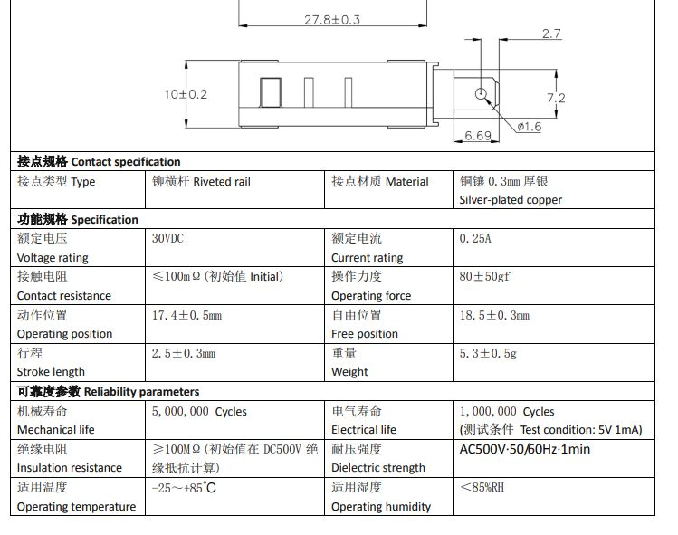

## Initial BOM

This is the Bill of Materials (BOM) I initially put together:

| Name | Store | Price (TTC) |
| :--- | :--- | :--- |
| [2-Pin Dupont Cable for Arcade USB Encoder (20pcs 4.8mm)](https://fr.aliexpress.com/item/1005004064421383.html) | Aliexpress | 4,35€ |
| [Arduino Leonardo R3](https://fr.aliexpress.com/item/1005007125126264.html) | Aliexpress | 5,89€ |
| [2 aluminum alloy buttons 30x25mm](https://fr.aliexpress.com/item/1005012720387050.html) | Aliexpress | 12,72€ |
| [Arcade miniature square push buttons, 33 mm](https://fr.aliexpress.com/item/33057798976.html) | Aliexpress | 2,56€ |
| [Photoelectric Incremental Rotary Encoder 38S6G5-B-G24N (360PPR)](https://fr.aliexpress.com/item/1005005071771659.html) | Aliexpress | 25,24€ |
| [Baolian Buttons 60x60mm (4 pack)](https://fr.aliexpress.com/item/1005010508363232.html) | Aliexpress | 26,24€ |
| [Rectangular LED-lit Light Switches, 50x33mm](https://fr.aliexpress.com/item/1005006120607662.html) | Aliexpress | 9,78€ |
| [V-10-1A4 SNAP ACTION microswitch; 10A/250VAC; 0.6A/125VDC; SPDT](https://www.tme.eu/fr/details/v-10-1a4/micro-interrupteurs-snap-action/omron-electronic-components/) | TME | 29,68€ |

### The hell to find springs
One thing I didn't expect was the difficulty of finding springs for the buttons.

While the springs that come with the Baolian button are pretty decent (they will need further testing regarding durability), the FX buttons came with way too strong springs, making it difficult to tap at a faster pace and breaking muscle memory.

Luckily, the springs on the FX and BT buttons are the same size and diameter, so I could technically use the same springs used in the BAOLIAN buttons.

Since every other option is too expensive and I didn't want to buy more, I decided for now to just **buy another pack of 4 BAOLIAN 60mm buttons** to extract the springs and keep the buttons for maybe a future [O.N.G.E.K.I.](https://en.namu.wiki/w/%EC%98%A8%EA%B2%8C%ED%82%A4%20%EC%8B%9C%EB%A6%AC%EC%A6%88) controller.

## The case

Many 3D models were made by others. I opted for a simple and arcade-accurate design that can be found [here](https://github.com/thomasstar/GJ-Tho-Voltex) (credits to `GJ-Tho-Voltex` by `thomasstar`).

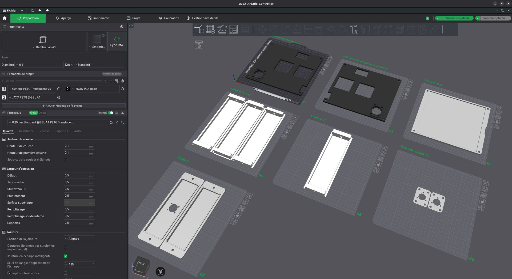

### Screws and inserts

This part can cost a lot if you don't have any store nearby. I chose to buy entire packs of screws instead of buying them unit by unit.

| Name | Store | Price (TTC) |
| :--- | :--- | :--- | :--- |
| [QUARKZMAN 60pcs Female Threaded Insert, M5 x 5mm x 7mm OD](https://www.amazon.fr/dp/B0G146N2PK?ref=ppx_yo2ov_dt_b_fed_asin_title&th=1) | Amazon | 10,39€ |
| [1080 Pcs M3 M4 M5 M6 Screws Bolts and Nuts](https://www.amazon.fr/dp/B0DCC9CJQ3?ref=ppx_yo2ov_dt_b_fed_asin_title) | Amazon | 14,98€ |

## Knobs Encoders

The knobs I bought for the encoders were accurate to the arcade version, but with one little issue: the screw for attaching the knob to the encoder's shaft was slightly too high. This was actually caused by the case design, which sits the encoders slightly lower relative to the controller's top surface, requiring the knobs to be lifted to prevent friction.

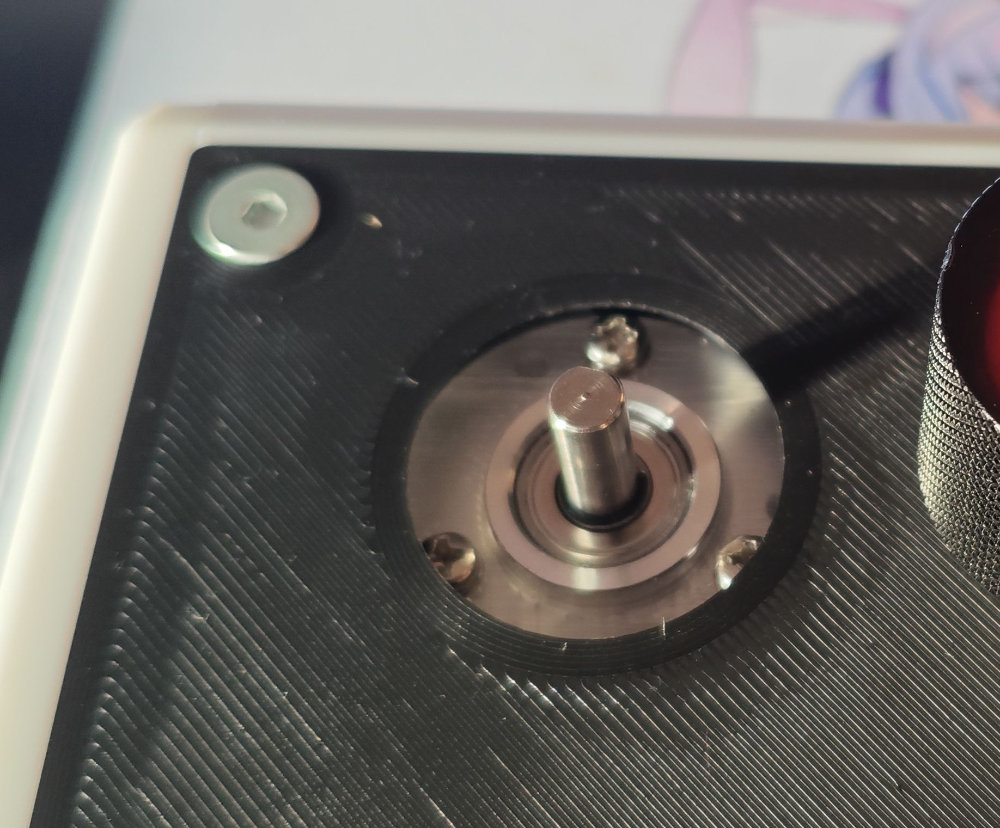

I was a bit bummed out because these are the only aluminum knobs available on AliExpress at a reasonable price in this specific size. That is why I set out to find a solution: why not print an adapter?

After multiple tries (about ten huh), I finally landed on this simple model:

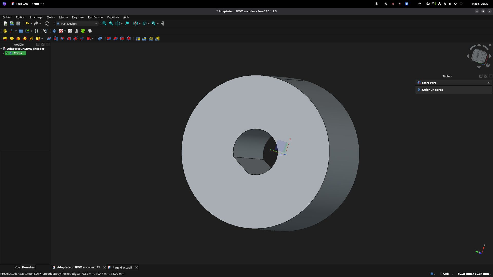

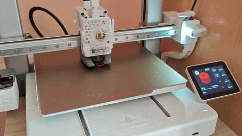

There is still some improvement that can be done, specifically on the friction to reduce free spinning by increasing the friction surface area.

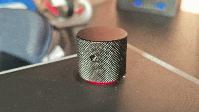

## Wiring

You will need 2 types of connectors for the buttons :
- For connecting microswitches : **4.8mm** spade connectors
- For connecting lights : **6.3mm** spade connectors

I originally bought female Dupont connectors, but I ended up replacing them with male ones to connect them directly to the Arduino, so I wouldn't recommend the female option. I also used leftover wire to make a common GND cable for the microswitches, which significantly reduces the amount of wiring inside the enclosure.

| Name | Store | Price (TTC) |
| :--- | :--- | :--- | :--- |
| [2-Pin Dupont Cable for Arcade USB Encoder (20x4.8mm)](https://fr.aliexpress.com/item/1005004064421383.html) | Aliexpress | 5,49€  |
| [Blub LED Light Cable for arcade cabinet (20x6.3mm)](https://fr.aliexpress.com/item/1005006091120389.html) | Aliexpress | 4,79€ |

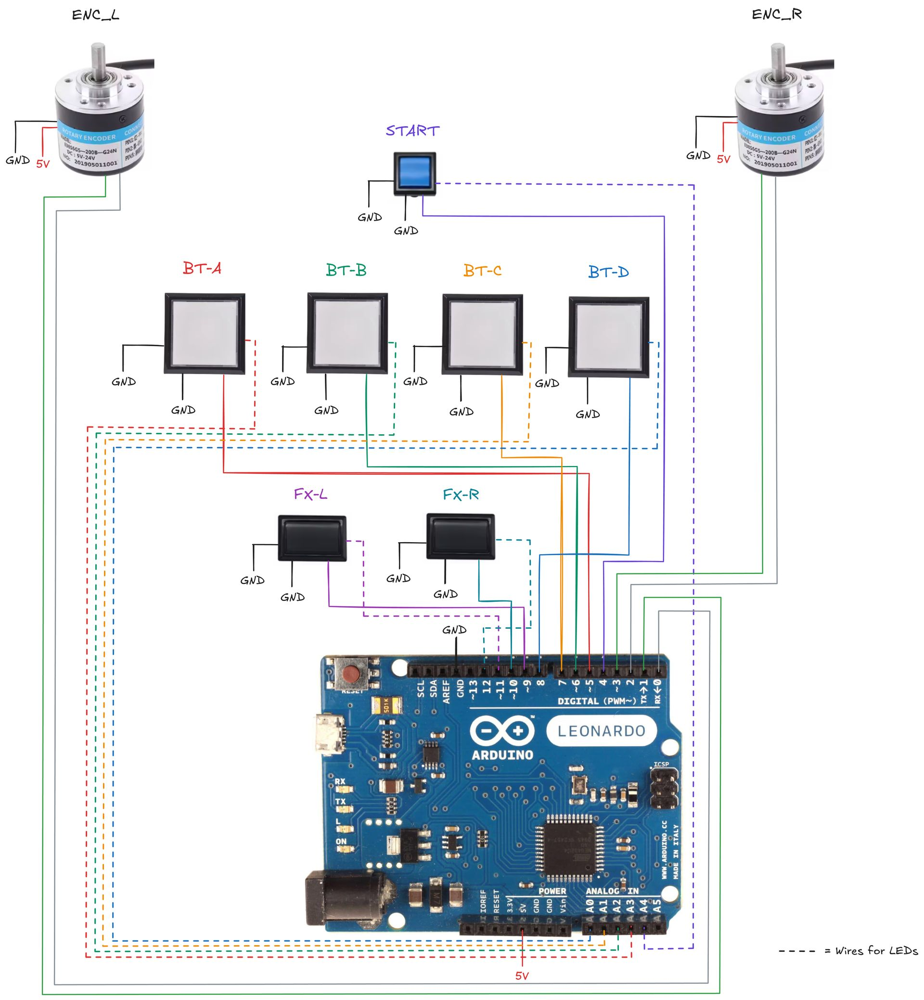

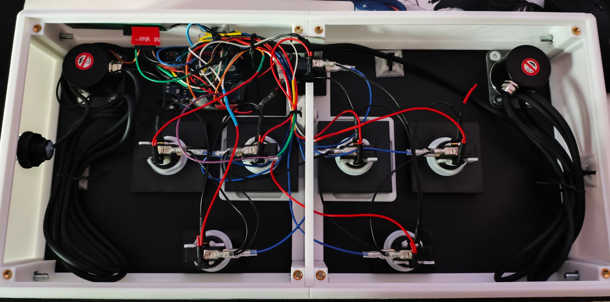

### USB-C connector

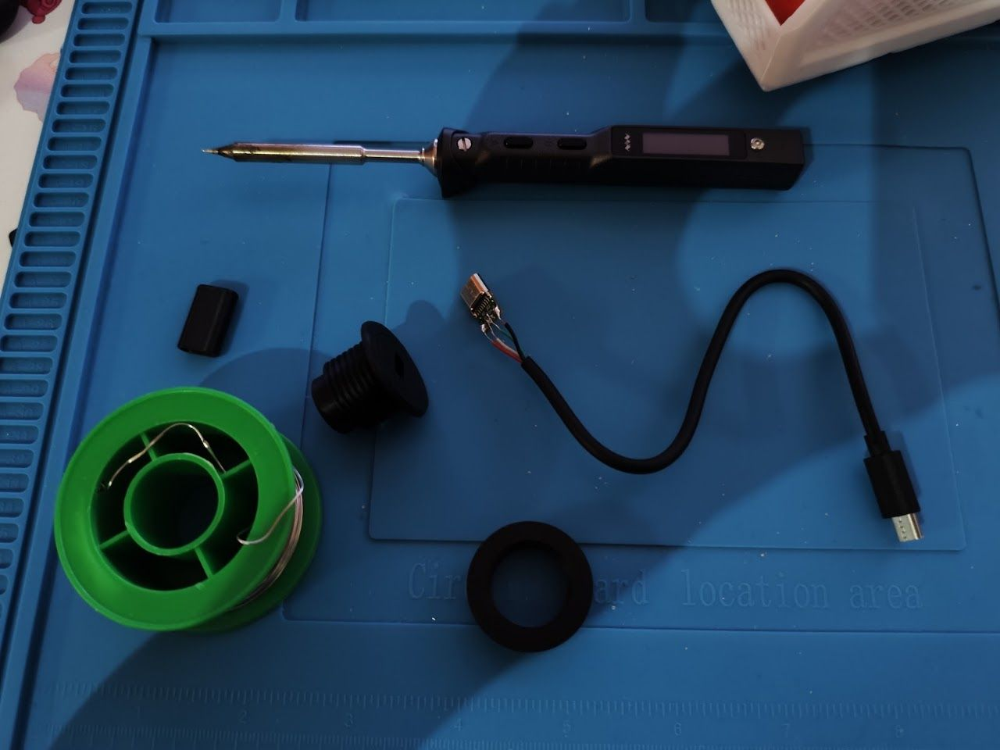

Credits for the [enclosure model](https://makerworld.com/en/models/1147028-usb-c-panel-mount-adapter-22mm-0-86in#profileId-1150466) : `beta3d`

## Building the firmware

There are many firmware out there, but i've choose to stick with [`SoundVoltexIO`](https://github.com/CrazyRedMachine/SoundVoltexIO/tree/encoder) by [`CrazyRedMachine`](https://github.com/CrazyRedMachine), which has support for chinese generic encoder (branch `encoder`).

You need to install `FastLED` and `Bounce2` libraries on the arduino IDE to get it running.

Testing the result with `evtest` showed working entries:

```bash
Event: time 1789633040.275304, -------------- SYN_REPORT ------------
Event: time 1789633040.286305, type 4 (EV_MSC), code 4 (MSC_SCAN), value 90009
Event: time 1789633040.286305, type 1 (EV_KEY), code 296 (BTN_BASE3), value 1
Event: time 1789633040.286305, type 3 (EV_ABS), code 0 (ABS_X), value 10
Event: time 1789633040.286305, type 3 (EV_ABS), code 1 (ABS_Y), value 10
Event: time 1789633040.286305, -------------- SYN_REPORT ------------
Event: time 1789633040.296304, type 3 (EV_ABS), code 0 (ABS_X), value 17
Event: time 1789633040.296304, type 3 (EV_ABS), code 1 (ABS_Y), value 16
Event: time 1789633040.296304, -------------- SYN_REPORT ------------
Event: time 1789633040.306305, type 3 (EV_ABS), code 0 (ABS_X), value 10
Event: time 1789633040.306305, type 3 (EV_ABS), code 1 (ABS_Y), value 10
Event: time 1789633040.306305, -------------- SYN_REPORT ------------
Event: time 1789633040.316304, type 3 (EV_ABS), code 0 (ABS_X), value 17
Event: time 1789633040.316304, type 3 (EV_ABS), code 1 (ABS_Y), value 16
Event: time 1789633040.316304, -------------- SYN_REPORT ------------
Event: time 1789633040.326303, type 3 (EV_ABS), code 0 (ABS_X), value 10
Event: time 1789633040.326303, type 3 (EV_ABS), code 1 (ABS_Y), value 10
Event: time 1789633040.326303, -------------- SYN_REPORT ------------
Event: time 1789633040.336304, type 3 (EV_ABS), code 0 (ABS_X), value 17
Event: time 1789633040.336304, type 3 (EV_ABS), code 1 (ABS_Y), value 16
Event: time 1789633040.336304, -------------- SYN_REPORT ------------
Event: time 1789633040.346304, type 3 (EV_ABS), code 0 (ABS_X), value 9
Event: time 1789633040.346304, type 3 (EV_ABS), code 1 (ABS_Y), value 10
Event: time 1789633040.346304, -------------- SYN_REPORT ------------
```

### Converting to platformIO project
While Arduino is great for prototyping, the IDE... (is not my cup of tea, to be nice ?)
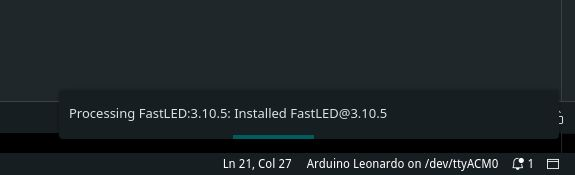

Migrating the project to a proper build system like [PlatformIO](https://platformio.org/) makes things a lot easier for future maintenance. Fork i've made with this migration can be found [here](https://github.com/lucagoc/YASDVXIO).

I've also fixed two bugs present in the firmware:
- There was conflicts with fastLED pins making BT-C and BT-D shining a bit
- Misuse of a struct due to libraries updates.

I might improve other things in the future, but for now i'm satisfy with this state.

## Finalization

### Greasing the buttons

The buttons made a bit of noise while tapping, especially a little striding sound, indicating potential friction with the spring and the plastic of the buttons.
I've bought a [silicon based grease](https://www.amazon.fr/dp/B0DJY6JLXJ) and put it small amounts on the springs, no more nasty sound while tapping.

| Name | Store | Price (TTC) |
| :--- | :--- | :--- |
| [20g Silicone Grease for Automatic Coffee Machine 2 x 10g tubes](https://www.amazon.fr/Graisse-Silicone-Tubes-Goupillon-Nettoyage/dp/B0GVS4DNXL) | Amazon | 5,99€ |

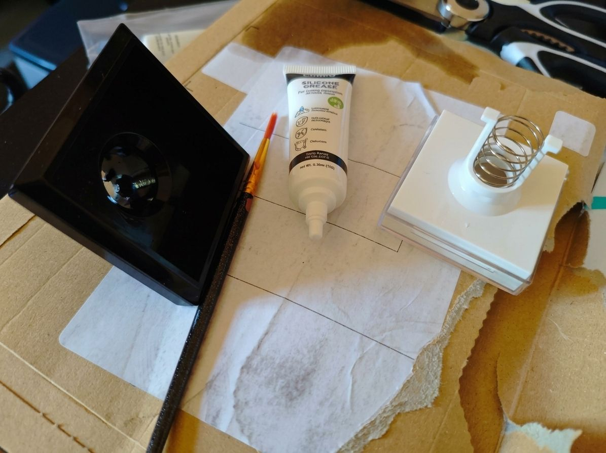

### Adding lights

The BAOLIAN buttons didn't came with lights, so i've had to buy them seperatly. Luckily those are really cheap and can be found on Aliexpress.

| Name | Store | Price (TTC) |
| :--- | :--- | :--- |
| [LED bulb lamp with push button 4.2 5V, 12V, 100 pcs](https://fr.aliexpress.com/item/1005006223437378.html) | Aliexpress | 6,19€ |

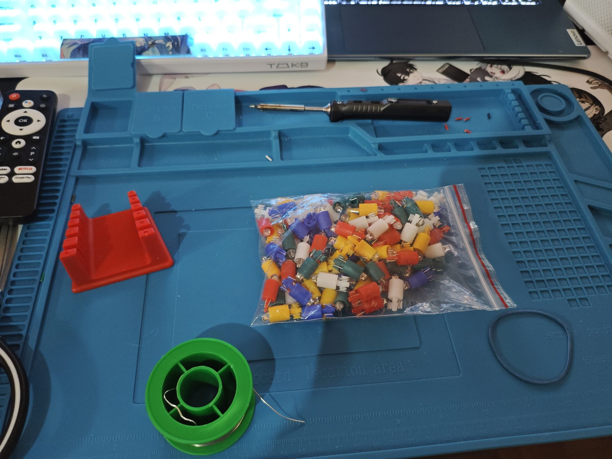

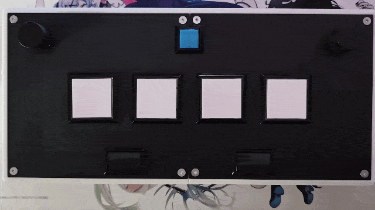

### Adding a Card Reader

You can find NFC readers for really cheap and it's a nice touch to the full arcade experience.

| Name | Store | Price (TTC) |
| :--- | :--- | :--- | :--- |
| [1 set of wireless PN532 NFC RFID V3 modules](https://fr.aliexpress.com/item/1005009519771350.html) | Aliexpress | 4,59€ |
| [Raspberry Pi Pico Board RP2040 PICO W Dual-Core 264KB ARM](https://fr.aliexpress.com/item/1005007393927221.html) | Aliexpress | 2,56€ |

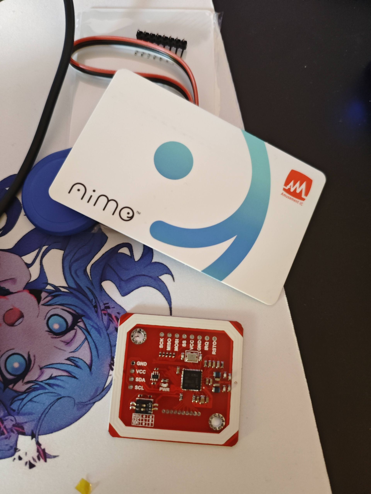

Credit for the casing and firmware [`aic_pico`](https://github.com/whowechina/aic_pico) by [`whowechina`](https://github.com/whowechina)

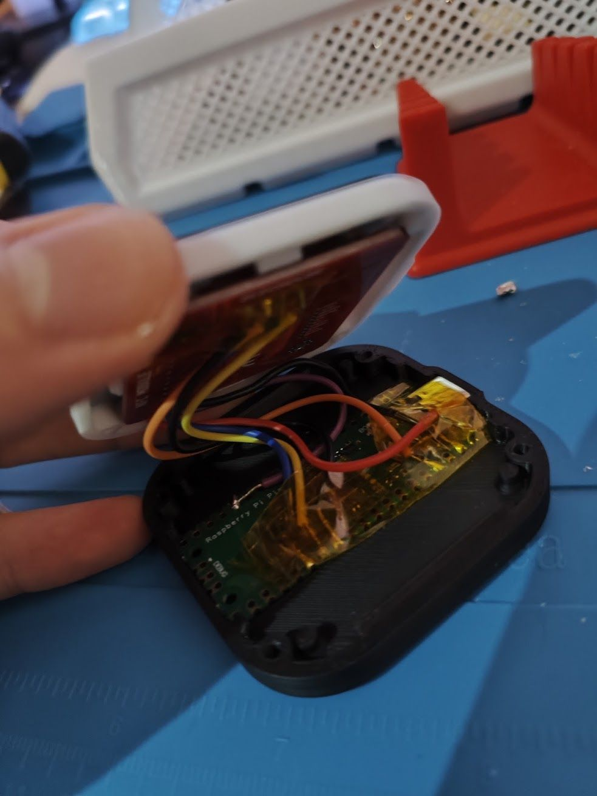

I've modified the case a bit to add the e-amusement logo at the center, creating a nice effect with the lights.

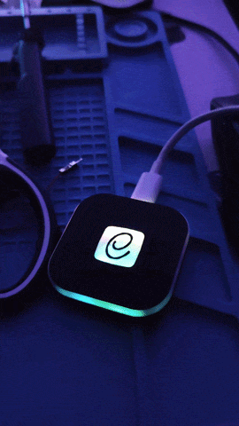

### Subscreen

This part goes a bit beyond the initial project, but the Valkyrie models cabs come with a touchscreen to interact with game settings. The original screen is about 22" (16:9 format). This size of screen is specifically difficult to find, but you can find alternatives 15.6" portable touchscreens on Aliexpress easily.

| Name | Store | Price (TTC) |
| :--- | :--- | :--- |
| [Portable Touch Monitor 15.6 inches 1920x1080P 60HZ](https://fr.aliexpress.com/item/1005012574738346.html) | Aliexpress | 83,55€ |

## Result

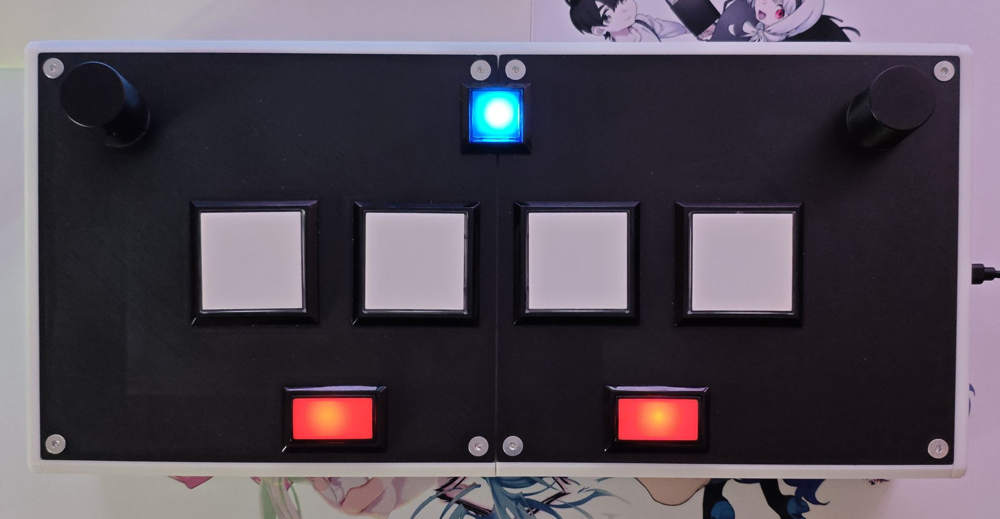

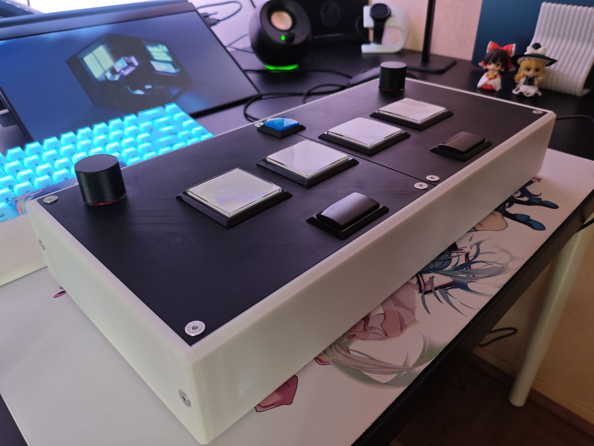

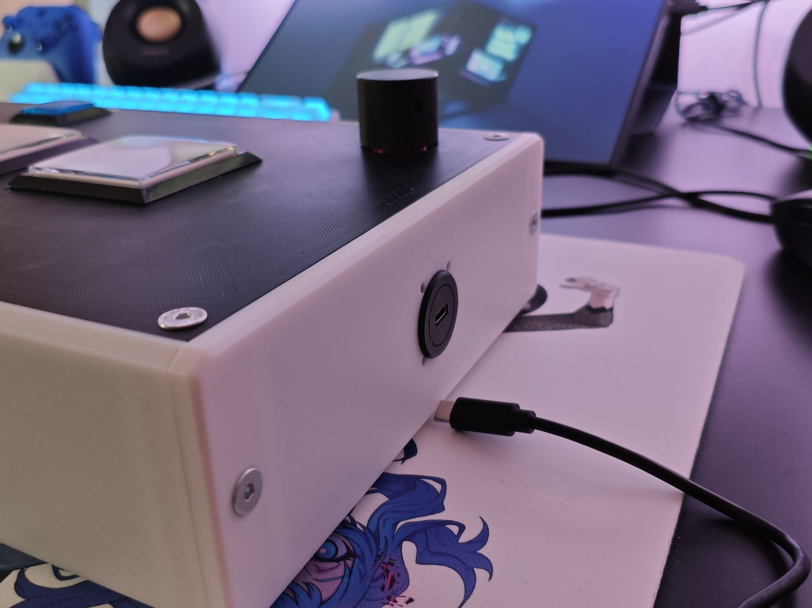

## Final BOM

### Controller

| Name | Store | Price (TTC) |
| :--- | :--- | :--- |
| [Arduino Leonardo R3](https://fr.aliexpress.com/item/1005007125126264.html) | Aliexpress | 5,89€ |
| [2 aluminum alloy buttons 30x25mm](https://fr.aliexpress.com/item/1005012720387050.html) | Aliexpress  | 12,72€ |
| [V-10-1A4 SNAP ACTION microswitch; 10A/250VAC; 0.6A/125VDC; SPDT](https://www.tme.eu/fr/details/v-10-1a4/micro-interrupteurs-snap-action/omron-electronic-components/) | TME | 29,68€ |
| [Photoelectric Incremental Rotary Encoder 38S6G5-B-G24N (360PPR)](https://fr.aliexpress.com/item/1005005071771659.html) | Aliexpress | 25,24€ |
| [ARCADE miniature square push buttons, 33 mm](https://fr.aliexpress.com/item/33057798976.html) | Aliexpress | 2,56€ |
| [Baolian Buttons 60x60mm (4 pack)](https://fr.aliexpress.com/item/1005010508363232.html) | Aliexpress | 26,24€ |
| [QUARKZMAN 60pcs Female Threaded Insert, M5 x 5mm x 7mm OD](https://www.amazon.fr/dp/B0G146N2PK?ref=ppx_yo2ov_dt_b_fed_asin_title&th=1) | Amazon | 10,39€ |
| [1080 Pcs M3 M4 M5 M6 Screws Bolts and Nuts](https://www.amazon.fr/dp/B0DCC9CJQ3?ref=ppx_yo2ov_dt_b_fed_asin_title) | Amazon | 14,98€ |
| [2-Pin Dupont Cable for Arcade USB Encoder (20x4.8mm)](https://fr.aliexpress.com/item/1005004064421383.html) | Aliexpress | 5,49€  |
| [Blub LED Light Cable for arcade cabinet (20x6.3mm)](https://fr.aliexpress.com/item/1005006091120389.html) | Aliexpress | 4,79€ |
| [Rectangular LED-lit Light Switches, 50x33mm](https://fr.aliexpress.com/item/1005006120607662.html) | Aliexpress | 9,78€ |
| [20g Silicone Grease for Automatic Coffee Machine 2 x 10g tubes](https://www.amazon.fr/Graisse-Silicone-Tubes-Goupillon-Nettoyage/dp/B0GVS4DNXL) | Amazon | 5,99€ |
| Total TTC | | **153,75€** |

*You can add roughly 10€ to 20€ of 3D printing cost.*

### Accessories

| Name | Store | Price (TTC) |
| :--- | :--- | :--- |
| [1 set of wireless PN532 NFC RFID V3 modules](https://fr.aliexpress.com/item/1005009519771350.html) | Aliexpress | 4,59€ |
| [Raspberry Pi Pico Board RP2040 PICO W Dual-Core 264KB ARM](https://fr.aliexpress.com/item/1005007393927221.html) | Aliexpress | 2,56€ |
| [Portable Touch Monitor 15.6 inches 1920x1080P 60HZ](https://fr.aliexpress.com/item/1005012574738346.html) | Aliexpress | 83,55€ |
| Total TTC | | **90,70€** |

*You can add roughly 2-5€ of 3D printing cost and LEDs.*

## Conclusion

Overall, I'm very happy with the setup. It's already way better than the official cheap Konami controller, and the result is really close to the arcade sensation.
Anyway, I hope you liked this little *journal of experiments*. I might write a more tutorial-oriented article in the future with the improvements I mentioned earlier...
I will first try playing with this controller a lot and update this article accordingly.
### Considerations for the future

#### Building my own case
While being functional, i would like to follow more closely the Valkyrie design of the original arcade cabinet.
Also soft PLA printed on a smooth PEI plate is mostly fine, but you can improve the sensation by using a real acrylic plate on top of the PLA to enhance the touch feeling on the controller.

#### Building my own PCB

A really cool addition would be adding my own PCB to connect the different components directly using standard JST connectors, which would drastically the number of cables make it look a lot cleaner. This is a costly addition, but it makes the internal wiring so much cleaner.

## Credits

This project was not possible without these incredible resources:
- The [rhythm-cons wiki](https://rhythm-cons.wiki/) which provides incredible resources and advice on getting parts.
- The original firmware [`SoundVoltexIO`](https://github.com/CrazyRedMachine/SoundVoltexIO) by [`CrazyRedMachine`](https://github.com/CrazyRedMachine).
- The casing design [GJ-Tho-Voltex](https://github.com/thomasstar/GJ-Tho-Voltex) by [`thomasstar`](https://github.com/thomasstar).
- The casing and firmware for the card reader [`aic_pico`](https://github.com/whowechina/aic_pico) by [`whowechina`](https://github.com/whowechina).